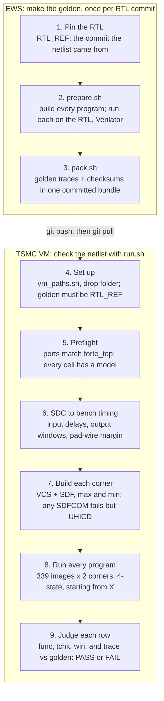

# FORTE post-PnR verification: onboarding

As of 2026-11-16. Live, editable copy: the team doc this file was exported from.

## The chip

FORTE/AMOEBA is the ECE 427 tapeout: an RV64GC Linux-capable core on TSMC 65 nm in about 1 mm², with no memory of its own. The core is OpenHW CVW `wallypipelinedsoc` with scalar crypto, and it reaches all memory through an FPGA on the board.

| Level | Module | What it adds |
| --- | --- | --- |
| Pads | `forte_top` | The pad ring. Under `SYNTHESIS` it instantiates the pad wrappers `io_in` / `io_out`; otherwise the pads are plain assigns. |
| Chip | `forte_chip` | Reset synchronisers, fault-inject synchroniser, DFT lock, the link to the FPGA |
| SoC | `forte_soc` | The CVW core (`hdl/core`) and the uncore: UART, CLINT, PLIC |

**Pins (31 signal pads).** `core_clk`, `rst_n`, the link (`io_in[7:0]` in, `io_out[7:0]` out, `req`, `wr`, `ready`, `rvalid`, `clk_out`), `irq[1:0]`, `uart_tx` / `uart_rx`, `test_mode`, `scan_en`, `fault_inject`, `status`.

**The link.** Two one-way 8-bit buses on `core_clk`; every memory access is a link transaction to the FPGA. That is why a pin-only bench can run whole programs: the bench is the FPGA.

**Caches use SRAM macros.** Under `SYNTHESIS`, `USE_SRAM=1` sends the caches through wrappers in `hdl/core/generic/mem/` to the `rf_sp_*` / `sram_sp_*` macros. The post-PnR netlist uses `sram_sp_128_137` and `sram_sp_128_53`.

## Two machines, one git branch

The golden is made on EWS and the netlist is checked on the TSMC VM; git is the only bridge, and the two machines cannot see each other.

| | EWS (local) | TSMC VM |
| --- | --- | --- |
| Has | RISC-V toolchain, Verilator, Spike, Design Compiler with FreePDK45 | VCS V-2023.12, the foundry cell, SRAM and pad models, the PnR outputs |
| Lacks | Any foundry file | Toolchain, Verilator |
| Does | Builds programs, runs the golden RTL, packs the bundle | Builds the netlist with SDF, runs every program, compares with the golden |
| Checkout | worktree `/home/sv34/ECE427/wt/postpnr` | `/groups/ece427-group4/post_pnr_tb/AMOEBA/` (a clone of `~/AMOEBA`) |

**Branch:** `postpnr_verif` on GitHub `CoreTyx/AMOEBA`. Work moves by `git push` on EWS, then `git -C ~/AMOEBA pull && git pull` in the VM checkout.

**On the VM, beside the checkout:**

- `vm_paths.sh`: the model lists and `PNR_DIR`. Never committed.
- `drop/`: what PnR produced (netlist `forte_top.pnr.v`, one min:typ:max SDF `forte_top.pnr.sdf`, SDC `forte_top.gate.sdc`) and, once known, `pnr.env` with `RTL_REF=<sha>`.

### IP rules

- Nothing from the foundry kit goes into git, a doc or a chat: no library file contents, no cell names, no `.lib` / model text, no SDF delay values. Paths are fine.
- On the VM, diagnose library questions with commands that print counts or pass/fail only (`postpnr/variants.sh` is built that way).
- Our own design's netlist and SDF lines, and our run logs, are fine to share.
- Commits on this branch carry no AI attribution lines.

## Repo map

For post-PnR work, `postpnr/`, `hvl/pin/` and the trace compare in `bin/` are what you touch; the rest is the design and the RTL-level verification it rests on.

| Path | What it is |
| --- | --- |
| `postpnr/` | The post-PnR flow: `prepare.sh`, `pack.sh` (EWS); `run.sh`, `variants.sh` (VM); `sdc_delays.py`, `sdf_out_wires.py`, `selfcheck.sh`, `waivers.txt` (empty by policy); the committed golden bundle `postpnr_bundle_<sha12>.tgz`; `README.md` (the full guide) and this file |
| `hvl/pin/` | The pin-only chip bench: `pin_tb.sv` with the link and UART agents, `pin_cycle_trace.sv`, `pin.sh` (build and run, RTL or gate), `tests/` (directed programs and command scripts), `models/` (local stand-ins for pads and SRAMs), `vm_paths.example.sh` |
| `bin/pin_trace_cmp.py` | Compares two runs' traces, cycle-exact by default |
| `hdl/forte_*.sv` | Chip-level RTL: pads, chip, SoC, uncore, link core and PHY, reset sync, DFT lock |
| `hdl/core/` | The working CVW core, the one that is built and edited (ECC caches, fault-tolerant shadow logic, SRAM wrappers) |
| `hdl/cvw/` | Pristine CVW copy from the submodule. Never edit. |
| `pkg/` | Configuration headers and types; `options.json` holds the project settings |
| `sim/` | Core-level simulation: Verilator or VCS with Spike co-simulation and the RVFI monitor |
| `hvl/{cache,cdc,ecc,ft_shadow}/` | Block-level testbenches |
| `testcode/` | Baremetal, FreeRTOS and Linux programs |
| `synth/` | Design Compiler. Locally with FreePDK45; `synth/timing/` is a flow calibrated to estimate 65 nm. The real synthesis and PnR run on the VM. |
| `sram/` | OpenRAM/FreePDK45 SRAM generator, local only |
| `docs/` | Plans and runbooks (top-level plan, memory map, post-synthesis VM runbook) |

## Verification layers

Each layer proves one thing and leans on the one before it; post-PnR sign-off proves the netlist equals the RTL, not that the RTL is right.

1. **Core RTL is correct** (`sim/`): every retired instruction is checked twice, by Spike co-simulation and by the riscv-formal RVFI monitor.
2. **Blocks behave** (`hvl/cache`, `cdc`, `ecc`, `ft_shadow`): directed testbenches for the caches, clock crossings, ECC and the fault-tolerant shadow logic.
3. **The chip works at its pins** (`hvl/pin`): a bench that plays the FPGA and touches only `forte_top`'s ports. The same bench runs the RTL, the synthesized netlist and the post-PnR netlist, selected only by the file list.
4. **The post-PnR netlist equals the RTL** (`postpnr/`): every program, both SDF corners, cycle-exact against a golden RTL run, with timing checks on.

The pin bench is 4-state on VCS: the chip's flops start X, unwritten memory can read X, and every pin it samples is checked with `$isunknown`. Under Verilator it collapses to 2-state, so a Verilator pass proves the bench and the flow, not X-cleanliness.

## How post-PnR verification works

The golden RTL runs every program once on EWS; the VM runs the same programs on the netlist with SDF and must reproduce the golden at every pin, every cycle, with no timing violation.



Details worth knowing:

- **One golden serves every corner and SDC.** Traces count `core_clk` edges from reset release and sample inputs at the edge, so they do not depend on the clock period or I/O delays. `postpnr/selfcheck.sh` proves it.
- **Every golden run must pass.** A failing program stops `prepare.sh` (or is dropped and named with `--drop-failing`).
- **Step 5** also warns when a cell is defined in more than one `STDCELL_MODELS` file, and refuses physical-only cells that connect anything but power.
- **Step 6:** `sdc_delays.py` turns the PnR SDC into the bench's launch delays and output windows. `sdf_out_wires.py` measures the pad-to-port wires VCS cannot annotate, and the max corner's window is tightened by the largest.
- **Step 7** compiles with timing checks on, negative limits honoured (`+neg_tchk`, `-negdelay`) and the models' `NTC` / `RECREM` switches defined.
- **Programs:** directed pin tests, baremetal, ISA, FreeRTOS, fault injection and 300 Cascade fuzz programs; Linux once its image is rebuilt.

## What PASS means

A row passes only when all four checks pass; each one covers something the others cannot.

```
PASS isa_tc_amo        max  func=PASS tchk=0 win=0 trace=MATCH
FAIL bm_sorting_algo   min  func=PASS tchk=3 win=0 trace=MATCH
```

| Field | Passes when | Covers | Checked by |
| --- | --- | --- | --- |
| `func` | The program exits 0 with no pin, protocol or X error | Function, as the board sees it | `hvl/pin/pin_tb.sv` and its agents |
| `tchk` | Zero VCS `Timing violation` lines (setup, hold, recovery, removal, width, period) | Timing inside the chip | The cell models' specify blocks, with the SDF's limits |
| `win` | Every output settles and holds inside its SDC window | Timing at the pads, which VCS's checks never see | `hvl/pin/pin_cycle_trace.sv` |
| `trace` | Pins every cycle, link transactions and console are identical to the golden RTL's | Equivalence with the RTL | `bin/pin_trace_cmp.py` |

A build fails before any row runs if its SDF does not annotate cleanly: any `SDFCOM_*` message fails it, except the pad-wire `UHICD` messages described under Policies.

Results land in `postpnr/results/<stamp>/SUMMARY` (paste this back) and `postpnr/results/<stamp>.tgz` (logs, traces, consoles).

## Running it

A new golden is needed only when the netlist comes from a different RTL commit; otherwise the work is all on the VM.

### On EWS: a new golden

```
cd /home/sv34/ECE427/wt/postpnr
postpnr/prepare.sh --rtl-ref <sha>     # every program on the golden RTL (Verilator)
postpnr/pack.sh                        # -> postpnr/postpnr_bundle_<sha12>.tgz
git add postpnr/postpnr_bundle_<sha12>.tgz && git commit && git push
```

Useful `prepare.sh` options: `--tiers` (default `directed,bm,isa,rtos,fi,linux,fuzz`), `--fuzz N` (default 300 Cascade programs), `--seed S`, `--jobs J`, `--linux-lst PATH`.

### On the VM: once per pull

```
git -C ~/AMOEBA pull
cd /groups/ece427-group4/post_pnr_tb/AMOEBA && git pull
tar -xzf postpnr/postpnr_bundle_<sha12>.tgz ./postpnr/golden    # only after a new bundle
```

Extract only `./postpnr/golden`: the whole bundle adds `BUNDLE.sha256`, and `run.sh` would then hold the checkout to the bundle's files and fail after the next pull.

### On the VM: each run

```
umask 002; module load vcs
python3 postpnr/sdc_delays.py ../drop/*.sdc         # the I/O timing the bench will apply
postpnr/variants.sh                                 # once: which STDCELL_MODELS order annotates cleanly
postpnr/run.sh --only '^smoke$' --corners max       # minutes: models, ports, SDF annotation
postpnr/run.sh --jobs 4                             # hours, inside tmux; each job holds a VCS licence
```

`PNR_DIR` comes from `vm_paths.sh` (the environment wins if set). Inside a new tmux window, run `umask 002` and `module load vcs` again.

| `run.sh` option | Does |
| --- | --- |
| `--only REGEX` | Only images whose name matches, e.g. `'^(smoke\|bm_\|isa_)'` |
| `--corners max,min` | Default both; or one |
| `--jobs N` | Simulations at once |
| `--no-build` | Reuse the corner builds |
| `--with-vcs-rtl` | Also run the golden RTL under 4-state VCS and compare |
| `--vm-paths FILE` | A different model-path file |
| `WAVES=1` (env) | A separate waveform build |
| `INITREG=0\|1\|random` (env) | Registers start at a value: triage only, never sign-off |

## Policies already decided

These are settled; change one only by agreement, and record why.

| Topic | Decision |
| --- | --- |
| Where things run | Gate+SDF on the VM; the golden locally with Verilator, pinned to the netlist's RTL commit by `RTL_REF` |
| Corners | Max and min, from the SDF's min:typ:max triples |
| Timing violations | Any VCS `Timing violation` fails its row. `postpnr/waivers.txt` stays empty. |
| SDF annotation | Any `SDFCOM_*` message fails the build, with one exception (next row) |
| Pad-wire exception (2026-11-16) | `SDFCOM_UHICD` on a wire from a pad driver to a `forte_top` output port is accepted: VCS cannot annotate wires that leave the annotated scope. `sdf_out_wires.py` measures the largest such wire, and the max corner's output window is tightened by it, so a pass still holds with the wire included. |
| I/O timing | From the PnR SDC, relative to `core_clk`. A positive output `-min` is checked as 0: what an edge launches cannot reach the pad before that edge. |
| Initial state | Sign-off starts from X. `INITREG` is for triage only, and every row says so when it is used. |
| Physical-only cells | Fill, decap, tap and endcap cells with no Verilog are listed in `IGNORE_CELLS`; the build refuses any such cell that connects a non-power pin. |
| Unit-delay SRAM models | `+define+ARM_UD_MODEL` is for zero-delay post-synthesis runs only; SDF builds drop it automatically. |

## Status and open items

The netlist compiles and elaborates on the VM, but no build has yet annotated its SDF cleanly, so no program has run on it. The blocker is `SDFCOM_CFTC`: timing checks the SDF has that the selected cell models lack.

### Where the VM has got to

| Step | Status | Notes |
| --- | --- | --- |
| SDC accepted | Done | `core_clk` 4 ns; inputs max 1.5 / min 0.4 ns; outputs max 1.5 ns, min checked as 0 |
| Preflight | Done | Model lists in `vm_paths.sh`; physical-only cells in `IGNORE_CELLS` |
| Compile and elaborate | Done | VCS V-2023.12 |
| `SDFCOM_NDI` (340, negative delays) | Fixed, untested on VM | SDF builds compile with `-negdelay` (`1b4671e`) |
| `SDFCOM_IANE` / `TANE` (5200, the SRAM macros) | Fixed, untested on VM | Unit-delay SRAM define dropped for SDF builds (`fd9fc7a`) |
| `SDFCOM_UHICD` (208, pad wires) | Fixed, untested on VM | Accepted and compensated (`fd9fc7a`) |

### What is left, in order

| Item | Status | What to do |
| --- | --- | --- |
| `SDFCOM_CFTC` (538): recovery/removal on async-reset flops, `$period` on the clock gate | Next | Run `postpnr/variants.sh` and keep, per threshold-voltage flavour, the `STDCELL_MODELS` file whose build shows only `UHICD`. If none models these checks, decide whether STA alone covers them, as a reviewed exception. |
| `RTL_REF` unknown | Open | Find the commit the netlist came from. If it is `8e27c2d`, write `RTL_REF=8e27c2da1fbced03250b01b124ee74f6ba75ece5` to `drop/pnr.env`; otherwise make and push a new golden. |
| `VCS_FLAGS` in `vm_paths.sh` | Open | Use `(-j4 -fgp)`: `-debug_acc+all -kdb` slow every run, and `WAVES=1` gives waveforms |
| `PAD_MODELS` has 881 files | Open | Narrow it to the files that define `io_in` / `io_out` and what they need |
| Smoke, then the full run | Open | 678 simulations: 339 images × 2 corners |
| Linux tier | Open | Optional: rebuild `testcode/linux` (the local `boot.lst` is stale), regenerate the golden with that tier, repack |

Not yet tested: DFT/scan (the bench's `dft` command is a stub).

## Traps learned

Each of these cost a VM round trip once.

**Model lists (`vm_paths.sh`)**

- The lists must be bash arrays in the file: `X=(a.v b.v)`. An array exported from the shell never reaches the scripts, and a quoted string `"a.v b.v"` becomes one bogus file name.
- `STDCELL_MODELS` are `-v` libraries: VCS takes each cell from the first file that defines it, so duplicate variants silently pick the wrong model. The preflight warns; `variants.sh` finds the right order.
- `PAD_MODELS`, `SRAM_MODELS` and `PDK_FIRST` compile as ordinary sources ahead of the design, so an over-broad glob can break the build.

**SDF annotation**

- A unit-delay model has no specify block, so nothing in the SDF can annotate it (`IANE` / `TANE`).
- An unchanged rebuild prints no annotation at all. The gate then relies on the `sdf_ok` record of the last clean annotation.
- A parse error (`SDFPE`) aborts annotation silently and the run continues with no delays; the gate fails it.

**Shell**

- `tmux new` does not carry `module load`, exports or `umask` into the new shell.
- In `gawk`, `\b` is a backspace, not a word boundary: use POSIX classes or `[^A-Za-z0-9_]`.

**Where to read more:** `postpnr/README.md` (the full guide), `hvl/pin/README.md` (the bench), `docs/postsynth_vm_runbook.md` (the post-synthesis VM flow).
