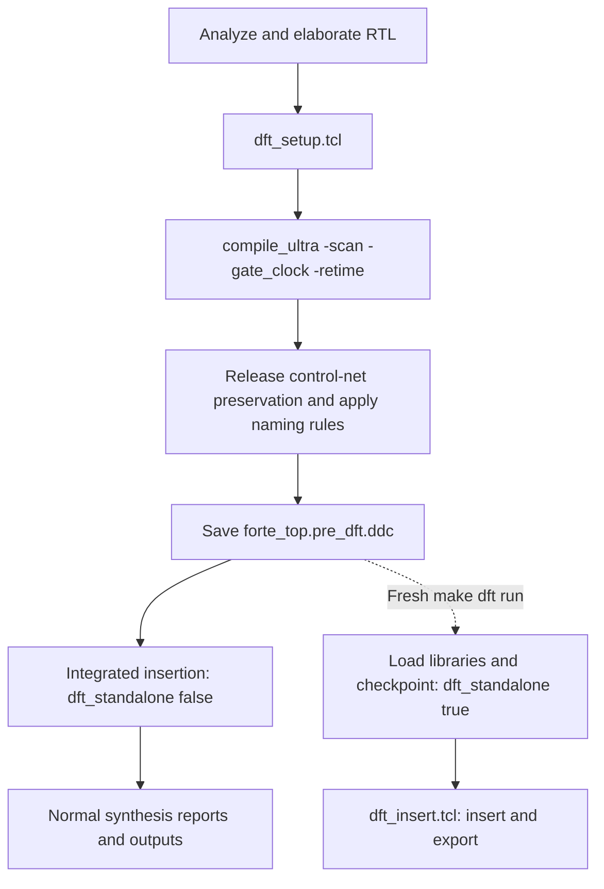

# PC-only DFT flow

## Purpose and scope

The flow prepares scan access to the fetch-stage program counter, PCF, and inserts eight scan chains at `forte_top`, through the ASIC pad ring. Internal objects are identified before compilation. A mapped, pre-insertion DDC checkpoint allows insertion to be repeated without rerunning synthesis or searching for renamed PC registers and control gates.

The current flow does not implement full-core scan, cache MBIST, ATPG pattern generation, or hardware scan verification. It makes no RTL changes.

## Files and execution order

| File | Role |
|---|---|
| [synthesis.tcl](synthesis.tcl) | Reads RTL, runs DFT setup, compiles, saves the prepared checkpoint, and runs integrated insertion |
| [dft_setup.tcl](dft_setup.tcl) | Identifies PC registers and test signals before compilation and applies scan/preservation attributes |
| [dft_insert.tcl](dft_insert.tcl) | Configures chain connections, runs DFT DRC and insertion, and exports scan information |
| [Makefile](Makefile) | Provides `make dft` to reload the checkpoint in a fresh DC session |



The checkpoint contains the mapped design and DFT attributes. Tcl variables such as `scan_regs` and `se_drv` are not the interface between processes; standalone insertion relies on the saved design attributes.

## Pre-compile setup: dft_setup.tcl

### 1. Select the ASIC top

```tcl
current_design $design_toplevel
```

Setup and insertion both operate on `forte_top`. The scan endpoints are package IO ports, so DFT analysis includes the pad ring. No hierarchy-preservation constraint is required on `chip`, `soc`, or `uncore`; internal control hookups are identified before mapping.

### 2. Preserve the control nets and lock-state interface

`scan_en_dft`, `test_mode_dft`, and the one-bit `dft_unlocked` net receive `dont_touch` attributes during compilation. The lock observation point is the driving leaf pin of `dft_unlocked`, resolved before mapping, rather than a module port that would require preserving the SoC hierarchy.

This preservation is targeted. It does not freeze the whole processor or prevent mapping of the surrounding logic.

### 3. Select the scan registers

The `scan_reg_patterns` list contains hierarchical register-name patterns, initially `*/ifu/pcreg/q_reg*`. Add one pattern per line to select additional register groups. The script ORs the patterns in a single filter, selects only sequential cells, prints the total selected, and stops if the collection is empty. Overlapping patterns do not duplicate cells. Changing this list requires regenerating the synthesis checkpoint.

The resulting attributes have separate purposes:

| Command | Effect |
|---|---|
| `set_dont_retime $scan_regs true` | Prevents moving the selected PC register boundaries through logic |
| `set_scan_element false [all_registers -edge_triggered]` | Disables scan replacement for other edge-triggered state |
| `set_scan_element true $scan_regs` | Enables scan replacement for the selected state |
| `set_dont_retime ...dftlock... true` | Prevents retiming of the lock hierarchy |

Only the surviving mapped storage selected by these patterns is intended to enter the chains. Constant propagation and mapping can affect the final bit count, so the selected-object count is not a guarantee of chain length.

### 4. Declare existing tester controls

The setup requests ordinary muxed-D scan and disables clock mixing. Internal-pin DFT support is enabled for the lock and scan-enable hookups.

| Signal | Declaration |
|---|---|
| `core_clk` | Existing external scan clock, with rising/falling edge times of 45/55 |
| `rst_n` | Active-low reset |
| `test_mode` | Held high during test |

The external `core_clk` pad feeds both clock inputs of `forte_chip`. Only the package clock is declared for this top-level flow. The waveform uses library time units and a test period of 100 set during insertion. These commands describe tester timing; they do not create a hardware clock divider.

### 5. Model the unlocked test condition

The pre-compile driver of `dft_unlocked` is declared constant high for DFT analysis. This lets DRC analyze scan operation with the existing lock permitting access.

The declaration does not alter the hardware lock. A real test must initialize the lock through the reset/clock sequence. DRC accepting an unlocked assumption is not proof that the physical initialization sequence works.

### 6. Identify the gated control hookups

The script finds the existing `scan_en_dft` net, identifies its driving output pin, and declares that pin as the insertion hookup for the external `scan_en` control.

The existing RTL expression is:

```text
scan_en_dft = scan_en AND dft_unlocked
```

The current scan test assumes `test_mode=1`. This setup does not add test-mode qualification to that expression or implement a new authorization circuit.

The existing `test_mode_dft` driver is also declared as the `TestMode` hookup associated with the external `test_mode` port. Inserted test-mode logic must use this lock-qualified source; the existing RTL already uses it to select scan pad directions and the output mux.

Both hookups are declared before mapping. Correct propagation of that internal hookup through compilation and DDC reload must be confirmed in the actual DC run.

### 7. Declare the scan data interfaces

For `k = 0..7`, the setup declares:

```text
io[k]   : scan input
io[k+8] : scan output
```

These are the existing bidirectional package ports: the tester drives the lower byte and receives the upper byte. The pad library models must allow DC to trace the input/output paths and recognize the test-mode direction controls. The backslashes around brackets in Tcl expressions ensure names such as `io[0]` are passed literally rather than interpreted as command substitutions.

This step declares signal roles. It does not yet allocate PC cells to chains or stitch their serial connections.

### 8. Keep the ASIC top selected

The script leaves `current_design` at `forte_top` so the subsequent compile includes the complete ASIC hierarchy.

## Compilation and checkpoint: synthesis.tcl

After setup, synthesis executes:

```tcl
compile_ultra -scan -gate_clock -retime
```

Scan-aware mapping uses the previously assigned scan-element attributes. Clock gating and retiming remain enabled, subject to the targeted preservation constraints.

The script then:

1. Releases `dont_touch` on `scan_en_dft`, `test_mode_dft`, and `dft_unlocked` so insertion can add connections and optimize the logic.
2. Applies the existing Verilog and custom naming rules.
3. Selects `forte_top` and saves `synout/forte_top.pre_dft.ddc`.
4. Sets `dft_standalone false` and sources `dft_insert.tcl`.
5. Continues with the normal synthesis reports and output files.

The saved checkpoint precedes insertion. An insertion failure therefore does not require another synthesis run unless the setup, RTL, or synthesis configuration needs to change. The checkpoint is replaced when synthesis is rerun, but insertion iterations only read it.

## Insertion: dft_insert.tcl

### 1. Choose integrated or standalone execution

`dft_standalone` defaults to true if the caller has not set it.

| Mode | Startup | Completion |
|---|---|---|
| `false` | Uses the design and libraries already loaded by synthesis | Returns to synthesis for normal reports and writes |
| `true` | Loads libraries and reads `synout/forte_top.pre_dft.ddc` | Writes the complete ASIC Verilog/DDC and exits DC |

Insertion reports always go to `synth/reports/dft/`, resolved relative to `dft_insert.tcl`, in both integrated and standalone modes. The insertion script does not change the synthesis flow's `REPORT_DIR`. `SYN_OUT_DIR` selects design outputs, with `outputs` as its fallback; the script creates the report and output directories.

### 2. Load libraries only for a fresh session

Standalone mode sets the library search path, target standard-cell library, DesignWare library, and SRAM link libraries using the same environment variables as the synthesis flow. It then reads the prepared DDC.

Integrated mode skips library and checkpoint loading. It inserts into the design that was just compiled.

### 3. Select the top-level insertion scope

The script selects and links `forte_top` and remains at that scope for insertion, reports, and protocol export. It does not rediscover mapped PC, lock-flop, or control gate names.

### 4. Configure chain connections

The insertion defaults are eight chains, period 100, internal-pin support, and no clock mixing. For each chain `k`:

```text
io[k] → input pad → selected PC scan cells → output mux/pad → io[k+8]
```

Scan-cell eligibility and internal hookups are carried by the prepared design. Before each chain is specified, insertion explicitly re-declares its stable input/output ports as `ScanDataIn` and `ScanDataOut` in the active design/test mode. This avoids relying on those port roles remaining active after compilation or checkpoint reload. No mapped internal-signal search is required. Chain count and endpoint assignments can be edited without rerunning compilation, within the available interface.

### 5. Set insertion policy

```tcl
set_dft_insertion_configuration \
  -preserve_design_name true -synthesis_optimization all -unscan true
```

- `preserve_design_name true` requests preservation of design names during insertion.
- `synthesis_optimization all` permits synthesis optimization during insertion to accommodate scan loading and improve the mapped result. It does not guarantee a particular area reduction.
- `unscan true` requests conversion of DRC-violating scan cells back to nonscan cells where supported. This can reduce unused scan-cell overhead but does not repair every testability violation. See the [Synopsys DFT Compiler documentation](https://picture.iczhiku.com/resource/eetop/whIERSaslUqroXnx.pdf).

### 6. Inspect, check, and insert

| Step | Command | Purpose |
|---|---|---|
| Inspect setup | `report_dft_signal -view spec` | Records restored scan-enable and data-interface specifications |
| Create procedures | `create_test_protocol` | Builds the test protocol from signal/timing declarations |
| Check input | `dft_drc -verbose` | Reports pre-insertion testability violations |
| Preview | `preview_dft -show all` | Reports the proposed scan architecture |
| Insert | `insert_dft` | Implements the scan connections |
| Check result | `dft_drc -verbose -coverage_estimate` | Reports post-insertion violations and a coverage estimate |

The coverage estimate is not generated ATPG patterns or measured fault coverage. DRC reports require review; the script does not automatically interpret all violations as acceptance or failure.

### 7. Finalize names and export test information

The script applies Verilog naming rules at `forte_top`, then writes the final chain report, test protocol, and SCANDEF at that same scope. This ordering keeps exported names consistent with the inserted design.

Standalone mode writes the complete Verilog and DDC; integrated mode returns to the synthesis script instead of exiting the process.

## Running and iterating

### Generate the checkpoint once

Run the established synthesis flow with the required Synopsys/TSMC environment and output directories configured. `synthesis.tcl` performs setup, compilation, checkpoint saving, and integrated insertion.

A checkpoint from the previous below-pad setup must be regenerated once with the top-level setup.

The previous `forte_top.gate.ddc` is not a substitute for the prepared `forte_top.pre_dft.ddc` unless it was saved with the required DFT setup. Changing this setup requires a new synthesis run.

### Repeat insertion

From the repository root:

```bash
make -C synth dft
```

Or from `synth/`:

```bash
make dft
```

The target requires the existing checkpoint, creates DFT-specific directories, and runs:

```tcl
set dft_standalone true
source dft_insert.tcl
```

It does not invoke synthesis or its clean target. Every invocation starts from the unchanged pre-insertion checkpoint. Reports and inserted outputs at the fixed DFT paths are overwritten on subsequent runs.

### Changes that require synthesis

| Change | Insertion-only iteration? |
|---|---|
| Chain count or connections using the declared ports | Yes, subject to a valid chain configuration |
| Insertion options, preview, DRC, and reporting | Yes |
| Test-period setting in `dft_insert.tcl` | Yes, with compatible clock-edge timing |
| Selected register population or scan exclusions | No; update `dft_setup.tcl` and regenerate the checkpoint |
| Internal signal hookups or preserved boundaries | No |
| RTL or synthesis/library configuration | Regenerate the checkpoint for a consistent comparison |

## Standalone artifacts

Paths below are relative to the repository root when using `make -C synth dft`.

| Path | Contents |
|---|---|
| `synth/synout/forte_top.pre_dft.ddc` | Input checkpoint; not overwritten by insertion |
| `synth/reports/dft/dft.log` | DC console log |
| `synth/reports/dft/dft_signals.rpt` | Restored signal specifications |
| `synth/reports/dft/dft_drc_pre.rpt` | Pre-insertion DRC |
| `synth/reports/dft/dft_preview.rpt` | Proposed architecture |
| `synth/reports/dft/dft_drc_post.rpt` | Post-insertion DRC and coverage estimate |
| `synth/reports/dft/dft_scan_path.rpt` | Final chains and scan-cell membership |
| `synth/synout/dft/forte_top.spf` | Top-level test protocol |
| `synth/synout/dft/forte_top.scandef` | Top-level scan-chain information |
| `synth/synout/dft/forte_top.gate.v` | Complete inserted ASIC Verilog |
| `synth/synout/dft/forte_top.gate.ddc` | Complete inserted ASIC DDC |

## Validation status

Local checks cover Tcl structure, Make command generation, and mocked integrated/standalone control flow. Actual DC execution must confirm that the pre-compile internal hookups survive mapping and checkpoint reload, that the pad models support top-level scan tracing, that the intended PC cells enter the chains, and that the exported protocol and netlist are consistent.

The first review points are `dft_signals.rpt`, `dft_preview.rpt`, both DRC reports, and the final chain report. Physical reset/unlock behavior, pad ownership, scan shifting/capture, and fault coverage require separate simulation and test validation.
