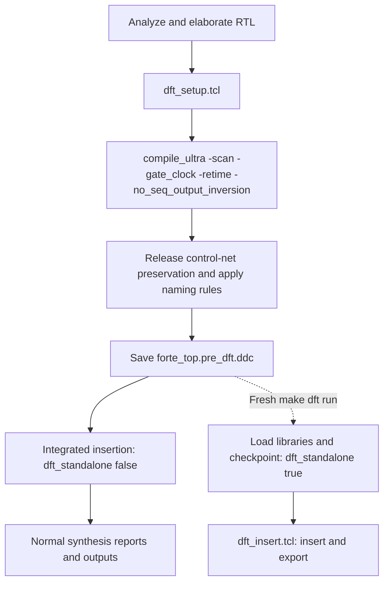

# DFT flow

## Purpose and scope

The flow inserts eight scan chains at `forte_top`, through the ASIC pad ring: chain `c<k>` runs from `io_in[k]` to `io_out[k]`. `DFT_SCOPE` (environment, default `pc`) picks what goes on them:

| `DFT_SCOPE` | Scanned state | Bench |
|---|---|---|
| `pc` | The fetch-stage program counter, PCF (63 cells) | `scripts/pc_tb/` |
| `full` | PC, pipeline stage registers and hardened CSRs (about 1,300 cells) | `scripts/full_tb/` |

Internal objects are identified before compilation. A mapped, pre-insertion DDC checkpoint allows insertion to be repeated without rerunning synthesis or searching for renamed registers and control gates.

The flow does not implement cache MBIST or ATPG pattern generation, and it makes no RTL changes. The benches in `scripts/` verify the inserted chains at gate level; see `scripts/HANDOFF.md` for the full hand-off notes.

## Files and execution order

| File | Role |
|---|---|
| [synthesis.tcl](synthesis.tcl) | Reads RTL, runs DFT setup, compiles, saves the prepared checkpoint, and runs integrated insertion |
| [dft_procs.tcl](dft_procs.tcl) | Shared procs: `dft_bind_hookups` (Q/QN-aware control hookups) and `dft_write_phase` (per-cell logical phase) |
| [dft_setup.tcl](dft_setup.tcl) | Selects the scan registers for `DFT_SCOPE`, identifies test signals before compilation and applies scan/preservation attributes |
| [dft_insert.tcl](dft_insert.tcl) | Configures chain connections, runs DFT DRC and insertion, and exports scan information |
| [Makefile](Makefile) | Exports `DFT_SCOPE` (`make synth DFT_SCOPE=full`) and provides `make dft` to reload the checkpoint in a fresh DC session |



The checkpoint contains the mapped design and DFT attributes. Tcl variables such as `scan_regs` and `se_drv` are not the interface between processes; standalone insertion relies on the saved design attributes.

## Pre-compile setup: dft_setup.tcl

### 1. Select the ASIC top

```tcl
current_design $design_toplevel
```

Setup and insertion both operate on `forte_top`. The scan endpoints are package IO ports, so DFT analysis includes the pad ring. No hierarchy-preservation constraint is required on `chip`, `soc`, or `uncore`; internal control hookups are identified before mapping.

### 2. Preserve the control nets and lock-state interface

`scan_en_dft`, `test_mode_dft`, `test_mode_s` (test_mode after the two-flop `tmsync` synchroniser), the one-bit `dft_unlocked` net and `hold_mode` receive `dont_touch` attributes during compilation. The `tmsync`, `sesync`, `hold_mode` and `holdlinksync` flops, like the lock, are kept non-scan and out of retiming, and the script errors if any of them matches nothing. It also errors unless the two RTL clock gates `chip/cg_ns` and `chip/cg_scan` exist (see [Hold-mode clock split](#hold-mode-clock-split)). The lock observation point is the driving leaf pin of `dft_unlocked`, resolved before mapping, rather than a module port that would require preserving the SoC hierarchy.

This preservation is targeted. It does not freeze the whole processor or prevent mapping of the surrounding logic.

### 3. Select the scan registers

`DFT_SCOPE` picks the groups: `pc` uses `scan_group_pc` (`*/ifu/pcreg/q_reg*`); `full` adds `scan_group_pipeline` and `scan_group_hardened_csr`. Each group is a list of hierarchical register-name patterns; add one pattern per line to an existing group. The script selects only sequential cells, prints the count per group and the total, warns on any pattern that matches nothing, and stops if a whole group is empty. Overlapping patterns do not duplicate cells. Any other value of `DFT_SCOPE` is an error. Changing the selection requires regenerating the synthesis checkpoint.

The resulting attributes have separate purposes:

| Command | Effect |
|---|---|
| `set_dont_retime $scan_regs true` | Prevents moving the selected PC register boundaries through logic |
| `set_scan_element false [all_registers -edge_triggered]` | Disables scan replacement for other edge-triggered state |
| `set_scan_element true $scan_regs` | Enables scan replacement for the selected state |
| `set_dont_retime ...dftlock... true` | Prevents retiming of the lock hierarchy |

Only the surviving mapped storage selected by these patterns is intended to enter the chains. Constant propagation and mapping can affect the final bit count, so the selected-object count is not a guarantee of chain length.

### 4. Declare existing tester controls

The setup requests ordinary muxed-D scan and disables clock mixing. Internal-pin DFT support is enabled for the lock and scan-enable hookups.

| Signal | Declaration |
|---|---|
| `core_clk` | Existing external scan clock, with rising/falling edge times of 45/55 |
| `rst_n` | Active-low reset |
| `test_mode` | Held high during test |

The external `core_clk` pad feeds both clock inputs of `forte_chip`. Only the package clock is declared for this top-level flow. The waveform uses library time units and a test period of 100 set during insertion. These commands describe tester timing; they do not create a hardware clock divider.

### 5. Model the unlocked test condition

After mapping, `dft_bind_hookups` (`dft_procs.tcl`) declares `dft_unlocked` and `test_mode_s` constant high, and `hold_mode` constant low, for DFT analysis. For each net, it traces back from the net's driver through buffers and inverters to the flop that drives it. It places the constant on that flop's Q or QN pin, with `-active_state` flipped once per inverter crossed, so a net that DC drives from QN still gets the correct value. This lets DRC analyze scan operation with the lock permitting access and with test mode already through the synchroniser.

The declaration does not alter the hardware lock. A real test must initialize the lock through the reset/clock sequence. DRC accepting an unlocked assumption is not proof that the physical initialization sequence works.

### 6. Identify the gated control hookups

The script finds the existing `scan_en_dft` net, identifies its driving output pin, and declares that pin as the insertion hookup for the external `scan_en` control.

The existing RTL expression is:

```text
scan_en_dft = scan_en AND dft_unlocked
```

The current scan test assumes `test_mode=1`. This setup does not add test-mode qualification to that expression or implement a new authorization circuit.

The existing `test_mode_dft` driver is also declared as the `TestMode` hookup associated with the external `test_mode` port. Inserted test-mode logic must use this lock-qualified source; the existing RTL already uses it to select what `io_out` carries.

Both hookups are declared before mapping. Correct propagation of that internal hookup through compilation and DDC reload must be confirmed in the actual DC run.

### 7. Declare the scan data interfaces

For `k = 0..7`, the setup declares:

```text
io_in[k]  : scan input
io_out[k] : scan output
```

These are the dedicated one-way link ports: the tester drives `io_in` and receives `io_out`, and no pad changes direction. The pad library models must allow DC to trace the input/output paths. The backslashes around brackets in Tcl expressions ensure names such as `io_in[0]` are passed literally rather than interpreted as command substitutions.

This step declares signal roles. It does not yet allocate PC cells to chains or stitch their serial connections.

### 8. Avoid inverted storage

The script sets `compile_seqmap_enable_output_inversion false`. That variable only affects `compile`; `compile_ultra` ignores it, so `synthesis.tcl` also passes `-no_seq_output_inversion` (next section).

### 9. Keep the ASIC top selected

The script leaves `current_design` at `forte_top` so the subsequent compile includes the complete ASIC hierarchy.

## Compilation and checkpoint: synthesis.tcl

After setup, synthesis executes:

```tcl
compile_ultra -scan -gate_clock -retime -no_seq_output_inversion
```

Scan-aware mapping uses the previously assigned scan-element attributes. Clock gating and retiming remain enabled, subject to the targeted preservation constraints.

`-no_seq_output_inversion` keeps every flop storing its RTL bit in true polarity. Without it, a FreePDK45 trial of the full scope stored 14 scan cells inverted (`FTStatusSticky[6]`, `AlignedInstrRawDFlop[2,3,5..15]`), and `full_tb` phase B read them back wrong. With it, cell area rose 0.46% and setup slack did not change.

The script then:

1. Binds the four control hookups (`dft_bind_hookups`) and releases `dont_touch` on `scan_en_dft`, `test_mode_dft`, `test_mode_s` and `dft_unlocked` so insertion can add connections and optimize the logic.
2. Applies the existing Verilog and custom naming rules.
3. Selects `forte_top` and saves `synout/forte_top.pre_dft.ddc`.
4. Sets `dft_standalone false` and sources `dft_insert.tcl`.
5. Continues with the normal synthesis reports and output files.

The saved checkpoint precedes insertion. An insertion failure therefore does not require another synthesis run unless the setup, RTL, or synthesis configuration needs to change. The checkpoint is replaced when synthesis is rerun, but insertion iterations only read it.

## Insertion: dft_insert.tcl

### 1. Choose integrated or standalone execution

`dft_standalone` defaults to true if the caller has not set it.

| Mode | Startup | Completion |
|---|---|---|
| `false` | Uses the design and libraries already loaded by synthesis | Returns to synthesis for normal reports and writes |
| `true` | Loads libraries and reads `synout/forte_top.pre_dft.ddc` | Writes the complete ASIC Verilog/DDC and exits DC |

Insertion reports always go to `synth/reports/dft/`, resolved relative to `dft_insert.tcl`, in both integrated and standalone modes. The insertion script does not change the synthesis flow's `REPORT_DIR`. `SYN_OUT_DIR` selects design outputs, with `outputs` as its fallback; the script creates the report and output directories.

### 2. Load libraries only for a fresh session

Standalone mode sets the library search path, target standard-cell library, DesignWare library, and SRAM link libraries using the same environment variables as the synthesis flow. It then reads the prepared DDC.

Integrated mode skips library and checkpoint loading. It inserts into the design that was just compiled.

### 3. Select the top-level insertion scope

The script selects and links `forte_top` and remains at that scope for insertion, reports, and protocol export. It does not rediscover mapped PC, lock-flop, or control gate names.

### 4. Configure chain connections

The insertion defaults are eight chains, period 100, internal-pin support, and no clock mixing. For each chain `k`:

```text
io_in[k] → input pad → selected PC scan cells → output mux/pad → io_out[k]
```

Scan-cell eligibility and internal hookups are carried by the prepared design. Before each chain is specified, insertion explicitly re-declares its stable input/output ports as `ScanDataIn` and `ScanDataOut` in the active design/test mode. This avoids relying on those port roles remaining active after compilation or checkpoint reload. No mapped internal-signal search is required. Chain count and endpoint assignments can be edited without rerunning compilation, within the available interface.

### 5. Set insertion policy

```tcl
set_dft_insertion_configuration \
  -preserve_design_name true -synthesis_optimization all -unscan true
```

- `preserve_design_name true` requests preservation of design names during insertion.
- `synthesis_optimization all` permits synthesis optimization during insertion to accommodate scan loading and improve the mapped result. It does not guarantee a particular area reduction.
- `unscan true` requests conversion of DRC-violating scan cells back to nonscan cells where supported. This can reduce unused scan-cell overhead but does not repair every testability violation. See the [Synopsys DFT Compiler documentation](https://picture.iczhiku.com/resource/eetop/whIERSaslUqroXnx.pdf).

### 6. Inspect, check, and insert

| Step | Command | Purpose |
|---|---|---|
| Inspect setup | `report_dft_signal -view spec` | Records restored scan-enable and data-interface specifications |
| Create procedures | `create_test_protocol` | Builds the test protocol from signal/timing declarations |
| Check input | `dft_drc -verbose` | Reports pre-insertion testability violations |
| Preview | `preview_dft -show all` | Reports the proposed scan architecture |
| Insert | `insert_dft` | Implements the scan connections |
| Check result | `dft_drc -verbose -coverage_estimate` | Reports post-insertion violations and a coverage estimate |

The coverage estimate is not generated ATPG patterns or measured fault coverage. DRC reports require review; the script does not automatically interpret all violations as acceptance or failure.

### 7. Finalize names and export test information

The script applies Verilog naming rules at `forte_top`, then writes the final chain report, test protocol, and SCANDEF at that same scope. This ordering keeps exported names consistent with the inserted design.

`dft_write_phase` then writes `forte_top.scan_phase.txt` beside the scandef: one `<instance path> <0|1>` line per scan cell, where 1 means the cell stores its RTL bit inverted. The phase is read from the netlist: a cell with both Q and QN pins is phase 1 when the net on its QN pin carries a design (RTL) name and the net on Q does not. Cells where both nets carry design names are reported as AMBIGUOUS. Single-output cells (Q-only, or QN-only such as TSMC's `SDFFQNX*`) can't be judged this way and are written 0; `-no_seq_output_inversion` is what guarantees they hold the RTL bit. The log line `DFT phase: N scan cells, M scan-out QN, S single-output, K stored inverted` should show `K = 0`; any phase-1 cell prints a warning and is listed in `reports/dft/dft_phase.rpt`. Scan-out from QN alone (an inverting chain hop) does not make a cell phase 1.

Standalone mode writes the complete Verilog and DDC; integrated mode returns to the synthesis script instead of exiting the process.

## Hold-mode clock split

### What the RTL does

`hdl/forte_chip.sv` splits `core_clk` through two instances of `hdl/forte_clk_gate.sv` (a latch, transparent while the clock is low, and an AND):

| Instance | `en` | `te` | Clocks |
|---|---|---|---|
| `cg_ns` | `~hold` | `1'b0` | every non-scan register, `forte_soc` included |
| `cg_scan` | `~hold` | `scan_en_dft` | exactly the scan-selected registers |

`hold = test_mode_dft & hold_mode`. `hold_mode` is `scan_en` (through the two-flop `sesync`) sampled while `test_mode_s` is low, so it freezes when test mode is entered: raise `scan_en` before `test_mode` for hold mode, keep it low for legacy test mode. `scan_en_dft` is now `scan_en & test_mode_dft`. `holdlinksync` carries `hold` into the `link_clk` domain. `tmsync`, `sesync`, `hold_mode` and the reset synchronisers stay on the ungated clocks.

| Mode | `hold` | `cg_ns` | `cg_scan` |
|---|---|---|---|
| Functional (`test_mode=0`) | 0 | passes | passes |
| Legacy test (`hold_mode=0`) | 0 | passes | passes (as before the split) |
| Hold (`hold_mode=1`) | 1 | stopped | passes only while `scan_en=1` |

In hold mode a shift clocks the chains and nothing else, so a scan dump no longer loads functional data into the register file, CSRs, UART and the rest. Capture is not possible in hold mode; ATPG and DRC use legacy test mode.

### What the scripts do

| Where | Step |
|---|---|
| `dft_setup.tcl` | Keeps `chip/sesync` as its own hierarchy with no boundary optimisation (see the note below); preserves `hold_mode` with the other control nets; keeps `sesync`, `hold_mode`, `holdlinksync` non-scan and out of retiming; errors if `chip/cg_ns` or `chip/cg_scan` is missing; keeps both as hierarchy (`set_ungroup false`, no boundary optimisation, no retiming) so their `gclk` pins survive mapping |
| `synthesis.tcl` | Analyses `forte_clk_gate.sv` before `forte_chip.sv` (with `FORTE_ICG_TECH` defined and `../io_drivers/forte_icg_tech.sv` analysed when that wrapper exists) |
| `synthesis.tcl`, after compile | `dft_check_hold_select chip`: `hold_mode_reg/D` must still be fed from `chip/sesync`, else stop (`DFT hold select: ...` in the log). `dft_check_clock_split chip`: every scan-selected flop is clocked through `chip/cg_scan`, and every flop under `cg_scan` is scan-selected. A mismatch lists the flops and stops synthesis (the second kind is only a warning with `DFT_SCOPE=pc`, which scans only the PC while `cg_scan` clocks the full-scope set). Then `dft_rtl_clock_gate_checks chip` logs what each gate became and adds `set_clock_gating_check -setup 0 -hold 0` on a discrete AND |
| `dft_bind_hookups` | `hold_mode`: `existing_dft Constant`, net value 0, traced Q/QN-aware like `test_mode_s` |
| `dft_insert.tcl`, before DRC | `dft_cg_exclusions chip`: sorts every integrated clock gate (ICG) into *rtl* (inside `cg_ns`/`cg_scan`), *hooked* (on the clock path of a scan-selected flop) and *excluded* (gates none), and passes rtl + excluded + the two gate instances to `set_dft_clock_gating_configuration -exclude_elements`. Errors if any scan flop is clocked through an excluded ICG. Logs `DFT cg: N ICGs hooked, M excluded (...), K inside chip/cg_ns and chip/cg_scan` |
| `dft_insert.tcl`, after `insert_dft` | `dft_check_cg_hookups`: hooked ICGs now have their test pin driven, excluded ones are still tied, the RTL gates' test pins are as before. Errors otherwise |
| `dft_insert.tcl`, after the scandef | `dft_check_clock_split` again, against the cells actually on the chains |

Clock tracing uses `all_fanout -flat -endpoints_only` / `all_fanin -flat -only_cells`, which cross buffers, the RTL gate's AND and an ICG's CK→GCK arc and stop at a register clock pin. ICGs are the leaf cells with `is_icg == true`; their test pin is the one whose library pin has `clock_gate_test_pin`.

**`sesync` and the ScanEnable declaration.** `dft_setup.tcl` declares `scan_en` as the ScanEnable port before compile, and test-ready compile then treats that port as inactive in functional logic. `scan_en`'s only functional load is `sesync`, so the first full-scope run (FreePDK45, 2026-11-12) folded `sesync` away and tied `hold_mode_reg/D` to 0: hold mode could never be selected, every session was a legacy one, and full_tb phase S caught it (no chain shifted under a hold). Keeping `chip/sesync` as a hierarchy without boundary optimisation stops the constant at its boundary; removing the pre-compile ScanEnable declaration also worked on the small model but changes more. `dft_check_hold_select` guards it.

### DC options (W-2024.09) and why these

- `set_dft_clock_gating_configuration [-exclude_elements object_list] [-dont_connect_cgs_of cell_list]` is all this release has (no `-control_signal`/`-depth`). `-exclude_elements` takes clock-gating cells, hierarchical instances containing them, lib cells or clocks, and leaves the excluded test pins as they are (tied stays tied, an existing connection stays). It overrides `-dont_connect_cgs_of`, which excludes the upstream gates of the listed registers only if they drive no valid scan cell. `set_dft_connect` has priority over both.
- The scripts compute the list and use `-exclude_elements` so the decision is explicit, logged and checked after insertion. On the trial design `-dont_connect_cgs_of <all non-scan flops>` gave the same hookups.
- `set_dft_configuration -connect_clock_gating disable` would leave every ICG unhooked, including those in front of scan flops, which then can't shift in legacy mode when their enable is low.
- `set_clock_gating_style -control_signal test_mode` would make the inferred ICGs transparent for the whole of test mode: the non-scan registers would again be clocked on every shift.
- `set_dft_clock_gating_pin` declares the test pin of a non-Power-Compiler gate so insert_dft hooks it; it is not needed (the RTL wires `cg_scan`'s `te` itself).
- Excluded ICGs keep `TE=0` in every mode: their registers load only on their own enable, also in legacy test mode. They are non-scan, so this costs no coverage of the chains; DRC reports them as nonscan cells disturbed during shift (`S19`) as before.

### How the RTL gate maps

Checked on FreePDK45 with a small model of the split (scratch, not in the repo):

| Form | Result after `compile_ultra -scan -gate_clock` | insert_dft without the exclusions |
|---|---|---|
| Behavioural latch + AND (as written) | `DLL` latch + `AND2` (+ `OR2` for `cg_scan`'s `en \| te`); not a clock gate to DC | nothing to hook; DRC passes the clock (latch constant 1 with `hold_mode=0`) |
| Same, plus `replace_clock_gates -global` before compile | the AND becomes a library ICG with its own `TE` tied 0; the RTL latch stays in front (two latches) | hooks that `TE` to scan enable in both gates: `cg_ns` would pass the clock on every shift |
| Library ICG instantiated (`ifdef`, directly or through a wrapper) | the ICG as written, `TE` tied 0 (`cg_ns`) or on `scan_en_dft` (`cg_scan`) | leaves both alone (no Power Compiler attributes); excluded anyway |

In every form insert_dft without the exclusions also hooked every inferred ICG, the non-scan ones included (today's behaviour). With the scripts, all forms gave the same result: only the ICG in front of the scan flops hooked, the others tied, the RTL gates unchanged, DRC 0 errors before and after insertion, the same DRC warnings as without the exclusions, and a slightly higher coverage estimate. Two cautions for the behavioural form: DC infers **no** clock-gating check on the discrete AND (the latch → AND → flop path is unconstrained), hence `dft_rtl_clock_gate_checks`; and the clock root is two loose cells for CTS. The preferred form for tape-out is a library ICG behind `ifdef FORTE_ICG_TECH` in `forte_clk_gate.sv`, through a one-cell wrapper `io_drivers/forte_icg_tech.sv` (pin names differ per library). `replace_clock_gates` is not used: it keeps the RTL latch and touches every manual clock gate in the design.

To list the library's ICG cells: `get_lib_cells */* -filter "defined(clock_gating_integrated_cell)"`.

### Open points

- Timing of `hold` → latch/ICG enable and of `scan_en` → `cg_scan` `te` (scan_en is a pin with input delay) is now on the clock path; check it in the scan-mode reports.
- With `DFT_SCOPE=pc` the pipeline registers sit under `cg_scan` but are not scanned: a hold-mode shift still loads them.
- `full_tb` exercises hold mode in phase S (`enter_hold`/`exit_hold`); `pc_tb` has no hold-mode test.

## Running and iterating

### The usual run

From `synth/` on the TSMC VM:

```bash
make synth DFT_SCOPE=full && make dft
```

`make synth` runs `make clean` (deleting `synout/` and `reports/`), then `synthesis.tcl`: setup, compilation, the checkpoint, integrated insertion, and the normal outputs in `synout/`. `make dft` then repeats insertion from the checkpoint into `synout/dft/`, which is what `scripts/full_tb` reads. Both insertions start from the same checkpoint with the same script. The `synout/` netlist, with its SDF and SDC, is the one for place-and-route.

Leave out `DFT_SCOPE=full` for the PC-only selection (`scripts/pc_tb`). The previous `forte_top.gate.ddc` is not a substitute for `forte_top.pre_dft.ddc`.

### Repeat insertion

From the repository root:

```bash
make -C synth dft
```

Or from `synth/`:

```bash
make dft
```

The target requires the existing checkpoint, creates DFT-specific directories, and runs:

```tcl
set dft_standalone true
source dft_insert.tcl
```

It does not invoke synthesis or its clean target. Every invocation starts from the unchanged pre-insertion checkpoint. Reports and inserted outputs at the fixed DFT paths are overwritten on subsequent runs.

### Changes that require synthesis

| Change | Insertion-only iteration? |
|---|---|
| Chain count or connections using the declared ports | Yes, subject to a valid chain configuration |
| Insertion options, preview, DRC, and reporting | Yes |
| Test-period setting in `dft_insert.tcl` | Yes, with compatible clock-edge timing |
| Selected register population or scan exclusions | No; update `dft_setup.tcl` and regenerate the checkpoint |
| Internal signal hookups or preserved boundaries | No |
| RTL or synthesis/library configuration | Regenerate the checkpoint for a consistent comparison |

## Artifacts

Paths below are relative to the repository root. The `synth/synout/dft/` and `synth/reports/dft/dft.log` entries come from `make dft`; `make synth` writes the same kinds of files to `synth/synout/` (plus `.gate.sdf` and `.gate.sdc`) and its log to `synth/reports/synthesis.log`. Both write the reports in `synth/reports/dft/`; the last run wins.

| Path | Contents |
|---|---|
| `synth/synout/forte_top.pre_dft.ddc` | Input checkpoint; not overwritten by insertion |
| `synth/reports/dft/dft.log` | DC console log |
| `synth/reports/dft/dft_signals.rpt` | Restored signal specifications |
| `synth/reports/dft/dft_cg_config.rpt` | Clock-gate exclusions passed to insert_dft |
| `synth/reports/dft/dft_drc_pre.rpt` | Pre-insertion DRC |
| `synth/reports/dft/dft_preview.rpt` | Proposed architecture |
| `synth/reports/dft/dft_drc_post.rpt` | Post-insertion DRC and coverage estimate |
| `synth/reports/dft/dft_scan_path.rpt` | Final chains and scan-cell membership |
| `synth/synout/dft/forte_top.spf` | Top-level test protocol |
| `synth/synout/dft/forte_top.scandef` | Top-level scan-chain information |
| `synth/synout/dft/forte_top.scan_phase.txt` | Per-scan-cell logical phase (1 = stored inverted) for the benches |
| `synth/reports/dft/dft_phase.rpt` | Per-cell Q/QN usage and phase, with totals |
| `synth/synout/dft/forte_top.gate.v` | Complete inserted ASIC Verilog |
| `synth/synout/dft/forte_top.gate.ddc` | Complete inserted ASIC DDC |

## Validation status

| Where | Scope | Result | Bench |
|---|---|---|---|
| TSMC 65nm, ece-427-02 (2026-11-12) | `full` | 1,297 scan cells, 8 chains of 162–163, all single-output cells, 0 stored inverted (`synout/dft/` from `make dft`) | `full_tb ./run.sh --regen +SCAN_OP=both`: every phase passes, 419 cases; `BREAK_SE` (17 errors) and `BREAK_MAP` (1) fail |

The local runs below used EWS with DC W-2024.09 and FreePDK45 standing in for TSMC (a copy of `stdcells.db` with `test_cell` added to the `SDFF*` cells; behavioural pads; SRAMs as black boxes):

| Scope | Result | Bench |
|---|---|---|
| `pc` | 63 cells, 8 chains (7 × 8 + 7), post-insertion DRC 0 errors / 0 fatals, phase file all 0 | `pc_tb`: `DFT TB PASS`; `BREAK_SE` and `BREAK_MAP` fail |
| `full` | 1,347 flops selected, 1,298 scan cells, 8 chains of 162–163, DRC 0 errors / 0 fatals, 0 stored inverted | `full_tb ./run.sh --regen +SCAN_OP=both`: every phase passes (419 cases, about 9 min); `BREAK_SE` and `BREAK_MAP` fail |

On the TSMC VM, check after each run: the per-group flop counts, the `DFT hookup:` lines (Q or QN, active state), `DFT phase: ... 0 stored inverted`, `reports/dft/dft_drc_post.rpt` (0 errors, 0 fatals), and `dft_preview.rpt` (8 chains, `io_in[k] -> io_out[k]`). Then run the bench that matches the scope: `full_tb` for `full`, `pc_tb` for `pc` (pc_tb fails D/E on a full netlist). Still open: 400 MHz timing with the full scope, fault coverage, and test-mode hold timing.
