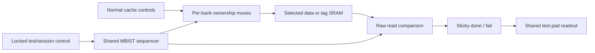

# FORTE DFT implementation plan

## Scope and design basis

The DFT architecture prioritizes partial scan of pipeline control, the fetch PC, and critical privileged state. Wider pipeline registers and a shared cache memory built-in self-test (MBIST) controller are additional area-dependent features. Full-chip scan, scan compression, logic BIST, a JTAG TAP, and SRAM repair are outside the minimum-area configuration.

The architecture basis is RTL revision `ede78e4`. Scan insertion runs separately in `dc_shell` on an existing mapped netlist and its functional SDC; the original synthesis script remains the upstream flow. Scan stitching, MBIST hardware, ATPG patterns, and measured DFT area overhead remain incomplete. The existing lock, pad multiplexing, and scan placeholders provide the interface foundation.

## Area constraints

Preliminary PnR reports 356,453 µm² used within 472,326 µm², or 75.5% utilization, excluding SRAM area. The resulting 115,873 µm² difference does not establish available DFT area. Macro footprints, halos, placement blockages, routing resources, clock-tree cells, and hold repair must be included in the placement budget. The 0.526 mm² pre-PnR estimate and 0.49 mm² target require consistent area accounting before comparison with these utilization figures.

Each candidate requires an explicit area allowance from the implementation floorplan. Area estimates must include scan-flop replacement, test control, memory ownership muxes, comparison logic, additional clock load, and timing repair. Matched synthesis reports provide the initial comparison; placement and timing results determine acceptance. No fixed percentage of DFT overhead is assumed.

## Existing implementation

| Component | Implemented state |
|---|---|
| Dedicated DFT pins | `test_mode` and `scan_en` |
| Shared scan data pins | `io[7:0]` inputs and `io[15:8]` outputs in authorized test mode; fixed per-bit pad directions |
| Scan paths | Eight one-flop `scan_q` placeholders in `hdl/forte_chip.sv`; processor registers are not stitched |
| Clock | Core and link clocks share the `core_clk` input at the top level; `clk_out` is a forwarded output |
| DFT lock | APB register at `0x0200F000`; reset permits DFT; writing bit 0 as zero locks DFT until reset; writing one cannot unlock it |
| Authorization | Lock qualification applies to test-mode pad remapping and scan shifting; shifting also requires test mode |
| Verification | `tcf_dft_lock.c` exercises register accesses and sticky locking; the pin bench's `dft` command is a stub |
| Cache SRAM | Two I-cache ways and four D-cache ways, each with separate data and tag banks; no MBIST controller or access muxes |

The scan architecture uses the eight channels reserved by the RTL pad mux.

## Area-dependent feature tiers

The tiers are cumulative feature configurations in increasing intended area order. Actual mapping, memory muxing, and timing repair may change the relative costs. Tier selection therefore depends on measured implementation results.

| Tier | Register and memory scope | Constraints |
|---|---|---|
| 0: interface baseline | Existing lock, pad mux, software tests, and ECC tests | No processor scan or MBIST coverage; scan placeholders do not test processor storage |
| 1: essential partial scan | IEU pipeline control/valid/destination state; fetch PC; privilege-mode data/check copies; status and interrupt CSRs; trap vectors, EPC/cause/delegation; PMP configuration/address registers; supervisor trap entry and `satp` | Initial insertion target; integer register-file storage and cache SRAM remain outside scan |
| 2: pipeline data and CSR expansion | Tier 1 plus instruction/PC pipeline boundaries, seven ECC-protected IEU operand/result registers with stored check bits, and remaining implemented machine/supervisor CSR storage | Arithmetic recovery/FSM registers require individual mapped-cell selection; entire arithmetic units are not selected solely to reach control state |
| 3: shared cache MBIST | Tier 2 scan plus one controller for all cache data/tag banks, raw-memory access muxes, sticky done/fail, and minimal readout | Twelve banks tested serially; no per-bank controllers, repair allocation, or wide failure log |
| 4: expanded observability | Tier 3 plus integer register-file storage, TLB/cache metadata, and remaining core state; optional compact first-failure recording | Subject to remaining area and timing margin; link falling-edge state requires a separate mixed-edge stitching and lockup design |

Tier 1 with shared MBIST is an alternative when the tier 2 datapath expansion does not fit. Its area is evaluated independently. The hookup file supplies the tier 1 mapped-register collection. Higher-tier scan populations require an extension of that collection; MBIST requires the additional controller and SRAM access RTL to be synthesized into the input netlist.

### Register selection

`scan_regs` in the site-specific hookup file identifies the mapped register cells selected for tier 1. Review of the loaded netlist and final chain report must confirm intended matches and implemented bit widths. Retiming, ungrouping, name conversion, and multibit mapping can remove the original RTL hierarchy or change register names. Selection therefore uses the actual netlist, rather than assuming that RTL instance patterns still match. A synthesized DDC or source-to-netlist mapping information can assist identification.

| Priority group | RTL reference instances for identifying mapped state |
|---|---|
| Pipeline control | `chip/soc/core/ieu/c/controlregD/E/M/W`, source/destination identifiers |
| Fetch and instruction boundaries | `chip/soc/core/ifu/pcreg`; instruction and PC stage registers |
| Privileged state | `chip/soc/core/priv/privmode`, `priv/csr/csrsr`, `csri`, `csrm`, and supervisor CSR instances |
| Encoded datapath boundaries | `chip/soc/core/ieu/dp/{RD1EReg,RD2EReg,ImmExtEReg,SrcAMReg,IEUResultMReg,WriteDataMReg,IFResultWReg}` |

PMP and `satp` receive priority because they determine protection and address translation. Selection of redundant state includes its physical data/check copies. Selection of encoded pipeline state includes stored codeword bits rather than only corrected outputs.

ATPG initialization must account for ECC and TMR consistency. Patterns may load inconsistent copies or codewords, which can activate recovery behavior during capture. Correction/recovery tests use deliberate corruptions and are distinct from ordinary logic fault patterns.

The lock flop, test-command/control latches, reset synchronizers, and memory macros remain excluded from scan replacement. Initial tiers additionally exclude the register-file array, large counters, and link/CDC datapath state. Register-object counts before mapping are not scan-bit counts.

### Chain organization

The initial architecture has eight uncompressed chains using the existing eight SI/SO pairs. Chain assignment balances scanned bits and physical locality. CSR membership remains identifiable in the chain map, without requiring every CSR to occupy chain 0.

One- or two-chain variants are optional area experiments. Fewer chains may reduce endpoint overhead but retain the scan mux cost per selected flop and increase shift time. A variant is accepted only if its muxing and timing costs provide a measured benefit.

## Test interface and authorization

The baseline scan configuration requires no additional pins.

| Signal | Test function |
|---|---|
| `test_mode` | Session-level selection qualified by `dft_unlocked` |
| `scan_en` | High for shift; low for capture within a scan session |
| `io[7:0]` | Eight parallel serial inputs |
| `io[15:8]` | Eight parallel serial outputs |
| `core_clk` | Tester-driven shift/capture clock; initial testing is slow and non-at-speed |
| `rst_n` | Reset and lock initialization |
| `clk_out` | Forwarded clock observation/timing reference |

The interface comprises two dedicated DFT controls and sixteen shared data pins, plus the functional clock/reset. Scan use disables the external memory link. The external agent must stop functional traffic and release the upper-byte pads before scan output is enabled.

### Scan hookup

Real scan endpoints replace the one-flop placeholders while retaining the pad mux. A preserved test-control boundary provides DC-resolvable internal hookup pins. Scan-cell enable and ICG test controls require lock-qualified authorization:

```text
authorized_test = test_mode AND dft_unlocked
scan_shift      = scan_en AND authorized_test AND scan_session
```

`scan_session` is constant true in a scan-only configuration and becomes the latched session selection when MBIST shares the interface. Raw `scan_en` must not bypass authorization. The lock must prevent shifting and pad remapping, rather than only hiding scan outputs. Authorization logic remains excluded from scan and from reset/clock fixes that would bypass it.

### Isolation, reset, and clock control

1. **APB isolation:** scanned APB state must not generate an unintended zero write to the lock. Functional APB transactions are inhibited during an authorized test session. This isolation is additional RTL; the existing lock register does not provide it.
2. **Memory and bus isolation:** functional SRAM writes and external requests remain inactive during shifting. Capture requires controlled or modeled nonscan state and memory/peripheral outputs. MBIST receives exclusive SRAM ownership.
3. **Reset initialization:** both reset synchronizers must reach defined state before shifting. Any test reset bypass must preserve the lock's authorization and reset semantics. Reset re-enables DFT.
4. **Clock-gate control:** the synthesis flow requests clock gating. Inserted ICG cells require lock-qualified test overrides and verified scan-clock controllability.
5. **External inputs:** `fault_inject` remains zero; interrupt and UART inputs remain at defined inactive levels. The DFT lock does not gate runtime fault injection.
6. **Return to operation:** destructive scan/MBIST is followed by reset and architectural/cache initialization. Boot software must clear the lock before untrusted execution. A production boot lock write remains an integration requirement.

The lock is volatile. It prevents software reopening DFT within a locked boot session but does not prevent access by an agent that controls reset.

## Cache MBIST architecture

### Memory scope

The configured caches contain six data banks and six tag banks, each 64 entries deep. Data words expose 137 bits: 128 payload bits and nine check bits. Tag words expose 53 bits: 46 payload bits and seven check bits. The linked memory inventory and compiler models must confirm the twelve physical instances and their widths.

MBIST ownership is inserted at the SRAM-wrapper boundary below ECC correction and tag-hit logic. The `ram1p1rwe` path reaches `ram1p1rwbe_64x137` and `ram1p1rwbe_64x53`, which instantiate `rf_sp_*` macros. Controls include active-low `CEN/WEN` and fixed `RETN/EMA`. This cache path uses full-word writes; the generic wrapper's `BWEB` interface does not establish physical bit-write-mask support.

The wrappers pad writes with three bits and discard three read bits. Physical testing of those bits requires confirmation of the compiler interface and access below that padding. Testing only the 137/53 visible bits is reported as logical-interface coverage.

### Shared controller and datapath



The minimum implementation uses one address counter, bank selector, phase controller, read/compare pipeline, and sticky result state. Banks run sequentially. All-zero/all-one expected values are generated combinationally without a wide pattern register.

Area evaluation includes both a shared-output mux/checker and local reduction checkers. A wide 12:1 read mux can offset shared-controller savings. CE, WE, address, and write-data muxes are included in functional timing and area assessment.

### Memory test algorithm

The proposed algorithm is word-oriented March C-minus:

```text
all addresses: write 0
ascending:    read 0, write 1
ascending:    read 1, write 0
descending:   read 0, write 1
descending:   read 1, write 0
all addresses: read 0
```

The sequence performs ten memory operations per address, or 7,680 operations across twelve 64-entry banks. Runtime additionally includes synchronous read latency, compare stages, and control overhead. The SRAM model defines legal read/write spacing.

Comparison uses raw SRAM outputs so ECC correction cannot conceal a storage fault. Fail status is sticky through completion. Reported coverage identifies the algorithm, tested word bits, and data backgrounds; exhaustive coupling, retention, timing, and write-mask fault coverage is not assumed. Additional address/checkerboard backgrounds and first-failure diagnostics are higher-area options.

MBIST is destructive and runs before normal cache use or with the processor isolated. Cache metadata is reset or invalidated before execution resumes. No repair resources are allocated. Software memory tests, demand-access ECC, and optional cache scrubbing do not replace raw data/tag SRAM testing.

### Shared-pin MBIST protocol

The zero-added-pin protocol latches a two-bit command from `io[1:0]` on the first `core_clk` edge of an authorized test session, with `scan_en=0`:

| Command | Session |
|---|---|
| `00` | Scan; subsequent `scan_en` selects shift/capture |
| `01` | Start cache MBIST once; processor scan remains inactive |
| `10` | Reserved for diagnostics; disabled in the minimum configuration |
| `11` | Reserved |

The command is captured once per test-mode entry. Live scan input bits are not combinationally decoded as mode controls. Command, entry-detection, and status state remain outside processor scan and reset between sessions.

During MBIST, the upper-byte pads report a defined status word containing done/fail/busy and reserved zeros. Completion status remains stable until session exit. Lock qualification applies to command capture, MBIST start, SRAM ownership, and result-pad remapping. This protocol and its controller are planned RTL; mode-entry, completion, reset, and lock behavior require pin-level verification.

### Optional additional pins

| Configuration | Added pins | Effect |
|---|---:|---|
| Shared scan and latched MBIST command | 0 | Existing pad allocation; requires session decoder/latches |
| `mbist_mode` input | 1 | Simpler session selection; remains test-mode/lock qualified; status uses shared data pins |
| `mbist_start`, `mbist_done`, `mbist_fail` | 3 | Separate control/status; start requires authorized test mode |
| Dedicated scan SI/SO pair | 2 | Separate narrow scan interface with longer shifts and additional pad/mux logic |
| Dedicated scan clock | 1 | Additional clock input and timing/reset constraints; unnecessary for the baseline tester-driven `core_clk` |
| JTAG TAP | Typically 4; optional reset adds 1 | Additional access/control infrastructure outside the minimum-area scope |

Pin additions require package and pad-ring review, including power/ground allocation. Pad area and routing are included in the tradeoff against session-control logic.

## Netlist-based DFT tool flow

### Inputs and invocation

`synthesis_dft.tcl` is a standalone `dc_shell` script for scan insertion on an existing mapped Verilog netlist. It does not analyze functional RTL, elaborate the processor, rerun `compile_ultra`, or replace `synth/synthesis.tcl`.

The input netlist is loaded with `read_verilog`, linked against the same implementation libraries, and constrained with its original functional SDC. The working DC environment supplies standard-cell, SRAM, pad, and clock-gate libraries. `TSMC_DB_FAST` sets the target library containing the required scan-cell equivalents; the existing `link_library` must resolve the netlist references.

| Variable | Input or output |
|---|---|
| `DFT_NETLIST` | Existing mapped Verilog netlist, including required subdesign definitions |
| `DFT_SDC` | Functional SDC for that netlist |
| `DFT_HOOKUP_TCL` | Site-specific mapped register/control/SI/SO definitions and test setup |
| `TSMC_DB_FAST` | Target standard-cell library containing scan equivalents |
| `REPORT_DIR` | Output directory for before/after area/timing and DFT reports |
| `SYN_OUT_DIR` | Separate directory for scan-inserted netlist, DDC, SDC, and protocol |

```bash
# Within the configured DC/library environment, from the repository root:
export DFT_NETLIST=/absolute/path/to/forte_top.gate.v
export DFT_SDC=/absolute/path/to/forte_top.gate.sdc
export DFT_HOOKUP_TCL=/absolute/path/to/hookup.tcl
export REPORT_DIR=/absolute/path/to/dft_reports
export SYN_OUT_DIR=/absolute/path/to/dft_outputs
dc_shell -f synth/dft/synthesis_dft.tcl
```

The input netlist remains the synthesis baseline. DFT results use separate `forte_top.dft.{v,ddc,sdc}` names, with `forte_top.scan.spf` for the test protocol. Output directories must differ from the input artifacts' locations when needed to preserve prior results. Library/tool setup and run records remain part of the established implementation environment.

`hookup.example.tcl` defines the integration variables. The completed file supplies `scan_regs`, mapped lock/control cells, lock-qualified mode/enable pins, and eight SI/SO pairs. The input netlist must contain the actual authorization, scan endpoints, reset/ICG control, and bus/memory isolation. A hookup file does not create those structures or replace the one-flop scan placeholders.

### Scan insertion sequence

1. **Read and link:** load the mapped Verilog, select `forte_top`, link the implementation references, and read the functional SDC.
2. **Select mapped state:** source the hookup definitions and record the input area's hierarchy and critical timing paths. Disable default scan replacement, enable the selected registers, and exclude the lock/control cells.
3. **Preserve authorization:** protect the already-mapped lock and test-control logic with `set_dont_touch` during insertion. Retiming and RTL-boundary preservation commands are unnecessary because this flow does not rerun synthesis or retiming.
4. **Specify scan architecture:** request eight uncompressed muxed-D scan chains with clock mixing disabled. Declare existing `core_clk` and active-low `rst_n`, lock-qualified internal mode/enable, and the eight SI/SO pairs. The tester waveform has period 100 and edges at 25/75 in library time units and adds no hardware clock divider.
5. **Replace and stitch:** create the test protocol, run pre-insertion `dft_drc`, preview the architecture, execute `insert_dft`, and repeat `dft_drc`. Gate-level insertion replaces eligible nonscan cells with scan equivalents and assembles the chains. Scan-related mapping/optimization may occur inside insertion even though no RTL compile is requested.
6. **Report and export:** apply Verilog naming rules, write the final chain report, record post-DFT area/setup/hold and constraint violations, and export the scan-inserted Verilog, DDC, functional SDC, and test protocol.

DFT DRC reports require review; they are not ATPG patterns or fault-coverage measurements. The declarations do not implement authorization, memory isolation, reset strategy, or MBIST. The actual scan population must be confirmed after replacement, particularly for multibit or specialized sequential cells without scan equivalents.

### Area comparison and remaining tool work

Before/after reports use the same input netlist, functional SDC, and libraries. This isolates replacement, stitching, control fanout, and scan-related optimization costs from an upstream synthesis rerun. MBIST controller/mux costs require a separate netlist containing that hardware and an equivalent baseline comparison. The complete candidate remains subject to the production placement allowance.

The input SDC may contain functional case assumptions or exceptions. Test initialization and test-mode timing require review against the scan protocol rather than relying only on functional timing reports. Existing clock gates must have usable lock-qualified test control; reading a mapped netlist does not add the required test authorization automatically.

DC can insert scan on mapped logic but does not generate an SRAM March controller through this sequence. MBIST RTL or generated IP is integrated upstream and synthesized into the input netlist. ATPG pattern generation, fault simulation, and physical timing closure remain separate steps.

## Verification and acceptance

| Stage | Required evidence |
|---|---|
| Inventory | Selected mapped bits, reviewed hierarchy matches, physical memory widths, scan-cell availability, and library units |
| Scan structure | Reviewed pre/post-insertion DFT DRC; actual membership, lock exclusion, chain lengths, clock-gate controls, reset initialization, and unchanged external ports |
| ATPG | Stuck-at patterns with partial-scan initialization as needed; detected, untestable, aborted, and excluded faults with an explicit coverage denominator |
| Gate-level simulation | Shift/capture and pattern execution; locked-mode shift/remap/MBIST attempts; reset reopening; sticky software lock; APB self-lock prevention; functional operation with test controls inactive |
| MBIST | All banks/addresses/intended raw bits exercised; injected memory faults detected; SRAM latency and ownership checked; completion/status verified across reset and lock transitions |
| Physical implementation | Total area, congestion, timing, clock load, hold repair, and test power compared with the production reference and matched baseline |

The retained configuration is the highest tier satisfying the explicit area/timing allowance and test objectives. Omitted scan populations and unimplemented MBIST features remain documented coverage limitations.

Script validation covers Tcl structure and mocked netlist-flow command ordering. Actual scan replacement, DFT DRC, area/timing changes, and test coverage require execution in the installed DC/TestMAX DFT environment.

## References

Repository sources: `hdl/forte_chip.sv`, `hdl/forte_top.sv`, `hdl/forte_dft_lock.sv`, `hdl/forte_uncore.sv`, `hdl/core/cache/cacheway.sv`, `hdl/core/generic/mem/ram1p1rwe.sv`, the 64x137/64x53 wrappers, `pkg/config.vh`, `testcode/isa_level_testing/tcf_dft_lock.c`, and `synth/synthesis.tcl`.

Vendor documentation: [Synopsys TestMAX DFT](https://www.synopsys.com/implementation-and-signoff/test-automation/testmax-dft.html), [TestMAX DFT training](https://training.synopsys.com/learn/courses/54/TestMAXDFTJumpstart), and [STAR Memory System datasheet](https://www.synopsys.com/content/dam/synopsys/implementation%26signoff/datasheets/star-bist-ds.pdf). Release-specific commands and protocol behavior are defined by the installed DC/DFT manuals.
