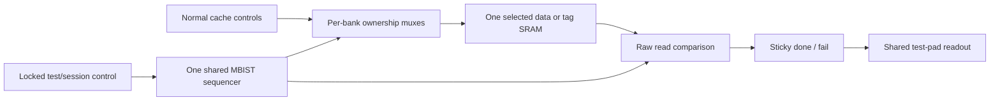

# Area-constrained DFT plan for FORTE

## Recommendation and limits

Start with **partial scan of pipeline control, the fetch PC, and critical privileged state**. Measure that candidate before adding wide datapath registers. In parallel, estimate a **single shared cache MBIST controller**; keep it only if its SRAM access muxes, comparison logic, and routing fit. Do not start with full-chip scan, scan compression, logic BIST, a JTAG TAP, or SRAM repair.

This is a proposed implementation plan, based on RTL revision `ede78e4`. It does not claim completed scan insertion, MBIST, ATPG coverage, or a measured DFT area overhead. The separate DC script is an adapted copy of `../synthesis.tcl`; the normal synthesis flow and RTL are unchanged. Current RTL can be inventoried and synthesized as a baseline, but needs the scan and MBIST integration described below before insertion.

For each candidate, account for the delta in scan-flop versus ordinary-flop area, scan/ICG/reset control, memory ownership muxes and checkers, added clock load, and timing/hold repair. Use matched library/mapping reports followed by placement, not a generic per-flop percentage.

The reported preliminary PnR utilization is 356,453 / 472,326 µm² (75.5%), **excluding SRAM area**. The numerical difference, 115,873 µm², is not a usable DFT budget: macro footprints/halos, placement blockages, routing, clock-tree and hold-fix cells are not accounted for by that subtraction. The older 0.526 mm² synthesis figure and 0.49 mm² target also cannot establish available placed area without reconciling their accounting. Obtain a small explicit cell-area allowance from the actual floorplan before accepting a tier; no percentage overhead is assumed here.

## Current implementation

| Item | What exists now |
|---|---|
| Scan pins | Dedicated `test_mode` and `scan_en`; sixteen memory-link pins are shared with scan |
| Scan data | In authorized test mode, `io[7:0]` inputs and `io[15:8]` outputs; fixed per-bit pad directions |
| Scan chains | Eight one-flop `scan_q` placeholders in `hdl/forte_chip.sv`; no stitched processor chains |
| Clock | Tester drives existing `core_clk`; top ties core and link clocks to this input. `clk_out` is a forwarded output, not a separate scan-clock input |
| Lock | APB register at `0x0200F000`; resets unlocked, bit-0 write of zero locks until reset; writing one does not unlock |
| Gating | Both test-mode pad remapping and scan shifting are lock-qualified; shifting also requires test mode |
| Verification | `tcf_dft_lock.c` tests the software register path; the pin bench's `dft` command is still a stub |
| Cache memory | Two I-cache ways and four D-cache ways, each with separate data and tag SRAM; no MBIST access mux/controller |

Older planning documents mention two scan chains. The current pad mux reserves **eight**. Use the RTL and this eight-channel plan as the starting point, rather than the older chain count.

## Tiers, from lowest intended area cost to highest

The tiers are cumulative feature choices, not measured area rankings. Actual mapping and timing repair can change the relative cost of wide scan versus MBIST. Compare both candidates before choosing the next step.

| Tier | Features | Priority and limitation |
|---|---|---|
| 0: existing infrastructure | Existing lock, pad mux, functional software tests and ECC tests; no processor scan or MBIST | Baseline only. The one-flop scan placeholders and ECC tests are not manufacturing memory test coverage. |
| 1: essential partial scan | IEU pipeline control/valid/destination state; fetch PC; privilege-mode data/check copies; status and interrupt CSRs; trap vectors, EPC/cause/delegation; PMP configuration/address registers; supervisor trap entry and `satp` | First insertion candidate. Exclude the large integer register array and cache SRAM storage. Fault coverage outside controllable/observable cones will be limited. |
| 2: pipeline data and remaining trap state | Tier 1 plus instruction/PC pipeline boundaries, the seven ECC-protected IEU operand/result registers including their stored check bits, and remaining implemented machine/supervisor CSR storage | Improves access to datapath boundaries without immediately scanning the register file. Review mapped recovery/FSM registers individually; do not include an entire arithmetic unit just to reach its control state. |
| 3: shared cache MBIST | Tier 2 scan plus one sequential MBIST controller serving all cache data/tag banks, raw-memory access muxes, sticky done/fail, and minimal result readout | Target all twelve banks, one at a time. No per-bank controllers, redundancy allocation, or wide failure log in the first version. Adds RTL; DC scan commands alone cannot implement it. |
| 4: expanded observability | Tier 3 plus integer register-file storage, TLB/cache metadata and remaining core state; optional compact first-failure address/bank recording | Only if measured area and timing permit. No commitment to full-chip scan. Keep link falling-edge state out until mixed-edge stitching/lockup and test timing are explicitly designed. |

If tier 2 is too expensive, also measure **tier 1 + shared MBIST** as an alternative; this is a separate candidate, not a claim that MBIST is free or cheaper. The supplied selector makes tier 3 use tier 2's scan population; edit the policy deliberately for that alternative and record the change.

### Register selection and chain layout

`scan_selection.tcl` is an initial hierarchy-based policy for the current RTL, not a verified mapped-cell list. Run inventory first and inspect every selected instance. Generic flops, generate blocks, optimization and multibit mapping can change the names and the number of register objects. Unmatched intended registers must be resolved before claiming that a tier is complete. Register-object counts before mapping are not flop-bit counts.

Relevant instances include:

- `chip/soc/core/ieu/c/controlregD/E/M/W` and destination/source register identifiers.
- `chip/soc/core/ifu/pcreg`, and instruction/PC boundary registers in tier 2.
- `chip/soc/core/priv/privmode` and `priv/csr/{csrsr,csri,csrm,...csrs}`. PMP entries and `satp` deserve priority because they determine isolation and translation.
- `chip/soc/core/ieu/dp/{RD1EReg,RD2EReg,ImmExtEReg,SrcAMReg,IEUResultMReg,WriteDataMReg,IFResultWReg}`. Scan stored codeword bits, not just corrected outputs.

Retain all physical copies of selected redundant state, including privilege check copies. Scan permits loading inconsistent ECC/TMR states: ordinary logic patterns must initialize them consistently, or ATPG must model their recovery behavior. Test correction/recovery separately with deliberate corruptions. Do not assume redundancy eliminates the need to observe individual storage bits.

Start with eight uncompressed chains using the available eight input/output pairs. Balance **scanned bits and physical location**, then preserve CSR identification in the chain map. Do not force every CSR onto chain 0 if that makes it the longest chain; this changes the older all-CSRs-on-chain-0 suggestion. Fewer chains may reduce endpoint overhead but do not remove the scan mux cost per selected flop. Test one/two-chain variants only if they recover useful area without requiring a costly new pad mux.

Permanently exclude the lock flop, test-mode control/command latches, reset synchronizers and memory macros from scan replacement. In initial tiers also exclude the register-file array, large counters, and link/CDC datapath state. The initial policy is conservative; expand it through reviewed cell lists and ATPG evidence, not a default full-scan fallback.

## Scan integration with pins and locking

No additional pin is required for the baseline scan plan:

| Signal | Use in test |
|---|---|
| `test_mode` | Session-level test selection, qualified by `dft_unlocked` |
| `scan_en` | Shift when high; capture when low, with the selected test session active |
| `io[7:0]` | Eight parallel serial inputs |
| `io[15:8]` | Eight parallel serial outputs |
| `core_clk` | External shift/capture clock; begin with slow, non-at-speed tests |
| `rst_n` | Initial reset and lock initialization; never bypass the lock's reset/security semantics |
| `clk_out` | Existing forwarded observation/timing reference, not a new scan clock |

There are two dedicated control pins, sixteen shared data pins, and existing shared clock/reset. Reusing pads makes the memory link unavailable during scan; the external agent must stop driving the upper byte and stop functional link traffic.

Replace the one-flop placeholders with real scan endpoints while retaining the existing pad mux. Add a preserved test-control boundary with DC-resolvable internal hookup pins. Drive actual scan-cell SE and ICG test controls from a signal equivalent to:

```text
authorized_test = test_mode AND dft_unlocked
scan_shift      = scan_en AND authorized_test AND scan_session
```

`scan_session` is constant true for a scan-only implementation; it becomes the latched session selection if MBIST shares the pins. Do not hook inserted scan cells directly to raw `scan_en`, add a parallel ungated tester path, or use the lock merely to hide scan outputs. Locking must prevent shifting and pad remapping. Preserve the lock and authorization logic through synthesis; exclude it from scan and from automatic reset/clock fixes that would bypass authorization.

Additional integration requirements:

Keep `fault_inject=0` during scan/MBIST and hold asynchronous interrupt and UART inputs at defined inactive levels. The DFT lock does not disable the separate runtime fault-injection mechanism.

1. **Prevent self-locking during shift.** Random scanned APB state must not synthesize a write of zero to the lock. Inhibit functional APB transactions while an authorized test session is active. The existing lock register does not implement this test isolation itself.
2. **Prevent unintended memory writes and external transactions.** Hold functional SRAM writes and bus requests inactive during shifting. For capture, model or initialize the remaining nonscan state, memory and peripheral outputs so ATPG does not rely on uncontrolled X values. An MBIST session gets exclusive SRAM ownership instead.
3. **Control reset.** Initialize both reset synchronizers before shifting; determine a test reset strategy for the scanned core. Reset bypass, if required, must never bypass authorization or place the lock into an ATPG-controlled chain. Physical reset continues to reopen DFT, as it does today.
4. **Control clock gates.** `options.json` permits synthesis clock gating. Provide lock-qualified test overrides and verify their connectivity. A scan declaration is not proof that every inserted ICG opens correctly.
5. **Exit deterministically.** Reset and reinitialize architectural/cache state after destructive scan/MBIST. Boot software must explicitly clear the lock before untrusted code runs; no production boot lock write was identified in the current checkout.

Reset reopens DFT. With no nonvolatile lock, this plan preserves the existing protection against software reopening scan during a boot session; it does not make scan inaccessible to someone who controls reset.

## Minimal shared cache MBIST

### Memory scope and insertion point

The current cache configuration has **six data banks and six tag banks**, each 64 entries deep. Data words are 137 logical bits (128 payload + 9 check bits); tag words are 53 logical bits (46 payload + 7 check bits). Confirm the twelve instances and physical widths from the linked memory inventory and actual compiler models before coding the controller.

Integrate test ownership at the SRAM-wrapper boundary, below cache ECC correction and normal tag-hit logic. The existing `ram1p1rwe` path reaches `ram1p1rwbe_64x137` / `ram1p1rwbe_64x53`, which instantiate `rf_sp_*` macros. Their macro controls include active-low `CEN/WEN`, and fixed `RETN/EMA`. The cache uses full-word writes on this path; `BWEB` on the generic wrapper is not evidence that the instantiated SRAM has bit-write enables.

The wrappers currently pad writes by three bits and discard three output bits. Test those physical bits only if the compiler model confirms them and the MBIST mux/checker is placed inside or below that padding. Testing just the 137/53 visible bits must be reported as that narrower coverage, not full physical-macro coverage.



Use one address counter, bank selector, phase controller, small read/compare pipeline, and sticky result state. Run banks serially. Generate all-zero/all-one expected patterns combinationally rather than storing a 137-bit pattern register. Compare shared-output-mux versus local reduction-checker implementations: a wide 12:1 read mux can outweigh the controller savings. Muxing CE, WE, address and write data is likely the main area/timing risk; measure it explicitly.

### Test sequence

Propose a word-oriented March C-minus sequence:

```text
all addresses: write 0
ascending:    read 0, write 1
ascending:    read 1, write 0
descending:   read 0, write 1
descending:   read 1, write 0
all addresses: read 0
```

This is 10 operations per address, or 7,680 memory operations across twelve 64-entry banks, **not** a guaranteed cycle count. Honor synchronous read latency and write/read spacing from the macro model; additional compare/control cycles are expected. A failure sets a sticky flag and remains externally observable through completion. Do not route reads through ECC correction, which could hide a faulty cell. Report the algorithm and word backgrounds used; do not claim exhaustive coupling, timing, retention or byte-mask fault coverage. The high-area tier can add address/checkerboard backgrounds and compact first-failure diagnostics after assessing the targeted fault model.

Testing is destructive. Run it before normal cache use or after isolating the processor, and reset/invalidate cache metadata before returning to execution. Without added repair resources this is test-and-report, not BISR. Software memory tests and the existing cache scrubber cannot substitute for this raw data/tag SRAM access path.

### MBIST control without new pins

A proposed zero-new-pin option is to latch a two-bit command from `io[1:0]` on the first `core_clk` edge of an authorized test session, with `scan_en=0`:

- `00`: scan session; subsequent `scan_en` selects shift/capture.
- `01`: start a cache MBIST session once; do not shift processor state.
- `10`: reserved for diagnostics; leave disabled in the minimal implementation.
- `11`: reserved.

Latch the command once per test-mode entry. **Do not combinationally decode the live scan input bits**, which change on every shift. The command latch, entry detector and status state are excluded from scan and reset between sessions. During MBIST, drive the shared upper-byte outputs with a defined status word, for example done/fail/busy plus zeros; hold it after completion until the session ends. This protocol is proposed RTL, not present functionality. Its initialization and mode-transition behavior need pin-level tests.

The lock must gate MBIST start, SRAM ownership, command capture and result-pad remapping, not merely the scan shift enable. An in-progress MBIST must not regain access after locking. With a test-active bus isolated as above, normal software cannot change the lock during that session; verify mode entry/exit and reset explicitly.

### Optional added pins

| Option | Added pins | Tradeoff |
|---|---:|---|
| Shared scan and latched MBIST command | 0 | Preferred pad budget; small session decoder/latches and a tester protocol |
| Dedicated `mbist_mode` input | 1 | Can simplify session selection; qualify with `test_mode` and the lock; still reuse data pins for status |
| Dedicated `mbist_start`, `mbist_done`, `mbist_fail` | 3 | Simpler external control/readout; more pads/package routing; start still needs authorized test mode |
| Dedicated scan SI/SO pair | 2 | Enables a separate narrow scan interface; longer shifts and new mux/pad logic; not a default area saving |
| Dedicated scan clock | 1 | Adds a clock domain/pad and reset/clock constraints; unnecessary when tester controls `core_clk` |
| JTAG TAP | Typically 4, optional fifth reset | Higher infrastructure and verification cost; omit from the minimum-area design |

Actual pad, power/ground and package budgets must be checked before adding any pins. Additional pads can consume more physical area than the small controller logic they replace.

## Design Compiler experiment

Files in this folder:

- `synthesis_dft.tcl`: adapted synthesis script with inventory, matched baseline and partial-scan modes; scan architecture, DRC, preview, insertion and protocol export commands.
- `scan_selection.tcl`: initial register-priority policy; tier 3 retains tier 2 scan population.
- `hookup.example.tcl`: intentionally incomplete integration contract for real internal pins, lock-qualified controls, reset, ICG and memory isolation.
- `constraints.sdc`: functional counterpart of the parent SDC with current link ports and a divide-by-one forwarded-clock declaration. Existing board/pad delay numbers remain placeholders. Supply actual constraints through `DFT_SDC`.
- `run.sh`: separate source lists and output directory; does not run the parent's `clean` target. It uses the existing root `hdl/prim_*` copies rather than analyzing duplicate third-party definitions.

Use the same actual libraries, SRAM models, period and implementation configuration for baseline and scan. The parent Makefile defaults to FreePDK45; that is not evidence of tapeout-process area. Do not use the timing flow's black-box calibration to assert final SRAM test coverage or physical area.

```bash
# Run after loading the site's DC environment and libraries.
# STD_CELL_LIB, STD_CELL_ALIB and SRAM_LIB can override parent-flow defaults.
synth/dft/run.sh inventory
synth/dft/run.sh baseline

# After RTL hookup/isolation is integrated and its exact DC pin names reviewed:
DFT_TIER=1 DFT_HOOKUP_TCL=/absolute/path/to/hookup.tcl \
  synth/dft/run.sh scan
```

The script inherits compile options from `options.json`, but preserves hierarchy and disables automatic ungrouping in both baseline and scan candidates. It refuses retiming for this first comparison. Compare to a matched baseline, not just the original flattened area number. It writes selected-instance and inventory reports before scan replacement. Source/configuration choices are recorded in each run directory; retain the full tool log for version and warnings.

Scan mode deliberately fails without real hookup pins and a ready configuration. Cumulative tiers 3/4 additionally require an integrated controller instance named by `DFT_MBIST_CELL`; the script does not create it. The example is not ready: the current `scan_q` paths do not provide a locked scan-cell enable distribution or real chain endpoints. Check internal-pin syntax against the installed DFT Compiler/TestMAX release and library. The script rejects insertion that adds top-level ports, and protects the lock/control boundary. It does not silently expose new tester pins or implement MBIST through a fictitious DC command.

`DFT_SCAN_PERIOD` defaults to 100 library time units as an exploratory slow test period; it is not an approved tester frequency. Functional timing remains the configured core period. Optional `DFT_MAX_MAPPED_AREA` is a cap on DC's mapped design-area attribute in the linked library's area units; it is not a post-route floorplan-utilization limit. No cap is inferred from the SRAM-excluding utilization figure.

DC can map and integrate a hand-written MBIST controller. Automated memory-test IP generation/insertion requires separately available tools, memory descriptions and licenses; Synopsys STAR Memory System is a separate memory-test/repair solution. See the [Synopsys STAR Memory System datasheet](https://www.synopsys.com/content/dam/synopsys/implementation%26signoff/datasheets/star-bist-ds.pdf). DC scan insertion by itself does not generate an SRAM March controller. ATPG also requires a separate pattern-generation flow/license; inserting chains and running DFT DRC do not establish fault coverage.

## Acceptance and stop points

1. Save baseline area by sequential cells, combinational cells, macros and hierarchy; enumerate selected **mapped bits**, physical memory widths, scan-cell availability and library units. Resolve missing hierarchy matches.
2. Evaluate tier 1 with eight uncompressed chains. Review pre/post-insertion DFT DRC, lock exclusion, actual chain membership, longest-chain length, ICG controls, reset initialization and absence of unexpected ports. Do not accept unexplained violations.
3. Generate stuck-at ATPG patterns using partial-scan-aware/sequential procedures where necessary. Report detected, untestable, aborted and excluded faults and the coverage denominator. Unscanned state may require initialization; it is not automatically controllable.
4. Simulate shift/capture and resulting patterns with real cell/pad models. Test locked-mode attempts to shift/remap/start MBIST; test reset reopening, one-way software lock, APB self-lock prevention and functional operation with test pins inactive. This extends the current register-only lock test and pin-bench stub.
5. Measure the tier 2 and shared-MBIST alternatives separately. For MBIST, inject memory faults into behavioral test models to check detection, cover every bank/address/raw bit, verify read latency, and test completion/status after lock/reset transitions. Then verify the actual SRAM-model integration.
6. Compare delta mapped area and post-placement timing/congestion with the matched baseline. Include scan clock load, hold buffers, lockup cells if any, memory muxes and test-mode power. Retain routing/CTS margin rather than filling the remaining placement capacity.
7. Stop at the highest tier that meets the explicit area/timing allowance and verified test objectives. If only tier 1 fits, document partial scan and omitted MBIST rather than claiming comprehensive manufacturing coverage.

## Sources

Repository basis: `hdl/forte_chip.sv`, `hdl/forte_top.sv`, `hdl/forte_dft_lock.sv`, `hdl/forte_uncore.sv`, `hdl/core/cache/cacheway.sv`, `hdl/core/generic/mem/ram1p1rwe.sv`, the 64x137/64x53 wrappers, `pkg/config.vh`, `testcode/isa_level_testing/tcf_dft_lock.c`, and the existing synthesis/clock constraints. Earlier pin/chain proposals are in `docs/impl_plan_link_clocking.md` §11.

Vendor references: [Synopsys TestMAX DFT](https://www.synopsys.com/implementation-and-signoff/test-automation/testmax-dft.html), [Synopsys TestMAX DFT training](https://training.synopsys.com/learn/courses/54/TestMAXDFTJumpstart). Verify the command options and test-protocol details using `man` in the installed DC/DFT release; they have not been executed in this workspace because `dc_shell` is unavailable.
